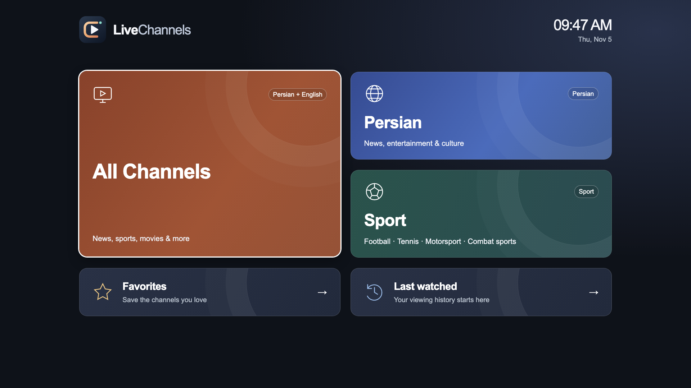
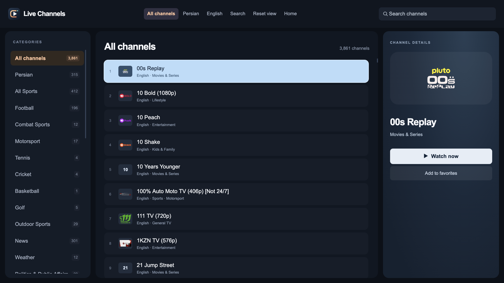

<p align="center"></p>
<h1 align="center">Live Channels for Samsung Tizen</h1>
<p align="center">A remote-friendly IPTV player with a unified Persian and English channel guide.</p>

Live Channels is a Samsung TV web app with a categorized guide, search, favorites, viewing history, and a full-screen player. It uses Samsung AVPlay and a bundled HLS.js compatibility player for streams that fail in AVPlay.

**Tested on:** a 2022 Samsung Q82B with Tizen 6.5. The manifest requires Tizen 6.5 or newer. Other TV models have not been verified. This is a developer-sideloaded app, not a Samsung app-store release.

## Features

- One merged catalog with Persian and English filters, duplicate-feed removal, and 32 content categories.
- A Persian category within All Channels and a Football category including potential soccer broadcasters.
- All Channels, Persian, Sport, Favorites, and Last watched dashboard shortcuts.
- Continuous channel browsing, search, logos, and channel details.
- Favorites and the last 20 opened channels saved locally on the TV.
- Physical remote Play, Pause, Play/Pause, Stop, and Return support.
- Telewebion stream resolution and HLS.js fallback for compatible HLS feeds.

The bundled catalog is a snapshot, currently containing 3,861 entries. Counts and availability change when refreshed. Football membership means a channel may carry soccer; it is not a live match schedule or a promise of access to a competition.

## Preview

Interface previews rendered in desktop Chromium; channel artwork and playback availability vary.





## Install on your Samsung TV

You need a computer, your TV and computer on the same network, a Samsung developer account, and Tizen Studio with the Samsung TV extension and Samsung Certificate Extension. Follow Samsung's [TV device setup](https://developer.samsung.com/smarttv/develop/getting-started/using-sdk/tv-device.html) and [certificate creation guide](https://developer.samsung.com/smarttv/develop/getting-started/setting-up-sdk/creating-certificates.html) for your model.

1. Install the TV SDK tools and Certificate Extension through Tizen Studio's Package Manager/Extension SDK manager.
2. On the TV, open **Apps**, enter **12345** to open Developer Mode, enable it, enter your **computer's local IP address**, and restart the TV. The exact input method can vary by remote/model.
3. Connect the TV in Tizen Studio's Device Manager, or use `sdb connect YOUR_TV_IP:26101`. Run `sdb devices` to check the connection and device name.
4. Create a **Samsung TV certificate profile** in Certificate Manager. Include your own TV's DUID in the distributor certificate. In Device Manager, use **Permit to install applications** when required by the SDK.
5. Clone this repository and build using your own certificate profile:

   ```sh
   git clone https://github.com/Saeed-rbh/live-channels-tizen.git
   cd live-channels-tizen
   bash scripts/build.sh YOUR_CERTIFICATE_PROFILE
   ```

6. Install and launch the signed widget:

   ```sh
   tizen install -n Live-Channels.wgt -t YOUR_DEVICE_NAME -- dist
   tizen run -p LiveChan01.LiveChannels -t YOUR_DEVICE_NAME
   ```

`YOUR_DEVICE_NAME` is the target shown by the SDK, not necessarily the TV's IP address. The application ID is `LiveChan01.LiveChannels`.

Put `sdb` and the Tizen CLI on your PATH. Typical locations under your Tizen Studio installation are `tools/sdb` and `tools/ide/bin/tizen`. Alternatively set `TIZEN_CLI` to the CLI's full path before running the build script:

```sh
export TIZEN_CLI="/path/to/tizen-studio/tools/ide/bin/tizen"
bash scripts/build.sh YOUR_CERTIFICATE_PROFILE
```

The shell build helper targets macOS/Linux. On Windows, use Tizen Studio to import `LiveChannels/` as an existing web project, select your Samsung certificate profile, then package and run on the connected TV. You can also run the equivalent CLI commands in a shell supported by your SDK.

**Why no ready-to-install widget?** Samsung developer installation uses signing profiles and TV DUID authorization. Build and sign for your own TV; this repository does not distribute the author's device-signed package or signing keys.

## Remote controls

| Control | Action |
|---|---|
| Arrow keys | Move between dashboard tiles, filters, categories, channels, and actions |
| OK/Enter | Open the focused item; select a channel to play |
| Play | Start the highlighted channel or resume playback |
| Play/Pause | Start the highlighted channel, then toggle pause/resume |
| Pause | Pause the current player, where supported by the stream |
| Stop | Stop playback and return to the guide |
| Return | Leave playback, step back through the guide, or return home |
| Search button | Focus the search input; text entry uses the TV keyboard |

Search currently filters the active language/category. From playback, OK or an arrow shows the overlay. Left/Right moves between Back and Pause/Resume. Pause support and how long a live stream can remain paused depend on its live window.

## Refresh or customize the catalog

The TV loads the bundled catalog immediately; **Reset view does not download playlists**. Refresh the snapshot on your computer, rebuild, and reinstall to distribute new channel data.

Requires **Node.js 18+**, **Python 3.9+**, and **curl**. No npm packages are required for the build-time catalog scripts.

```sh
python3 scripts/fetch-catalog.py
node scripts/build-catalog.cjs
bash scripts/build.sh YOUR_CERTIFICATE_PROFILE
```

- Edit [scripts/playlist-sources.json](scripts/playlist-sources.json) to configure upstream playlists.
- Edit [LiveChannels/curated.js](LiveChannels/curated.js) for preferred channel feeds.
- Edit [scripts/classify-channel.cjs](scripts/classify-channel.cjs) for content classification rules.
- Edit [scripts/football-candidates.cjs](scripts/football-candidates.cjs) for potential soccer broadcasters.
- `fetch-catalog.py` caches metadata and playlists in `.cache/catalog/`, which is ignored by Git.
- `build-catalog.cjs` writes `LiveChannels/catalog.js`. It keeps Persian/English entries using feed language metadata, channel metadata, and limited known-channel rules. Other or unidentified languages are excluded. Some retained feeds offer multiple languages.
- Classification is heuristic. General TV retains mixed-programming and unidentified channels. Repeated names are merged, and additional URLs are retained as metadata; automatic switching among those alternate URLs is not implemented.

## Development and tests

The app is plain HTML, CSS, and JavaScript. There is no frontend build step.

```sh
node tests/categories.cjs
node tests/football.cjs
node tests/player.cjs
```

These tests cover representative genre classification, football candidates, playback fallback, cancellation, and pause/resume behavior. They do not prove that third-party streams are currently available or play on every TV.

A desktop HTTP server can preview the interface:

```sh
python3 -m http.server 8080 --directory LiveChannels
```

Open `http://localhost:8080`. Desktop browsers use the HTML video path, and their media support differs from Samsung's AVPlay. Tizen Studio/real-device testing remains necessary.

## Troubleshooting

- **TV not connected:** check Developer Mode, the Host PC IP, your TV's IP, and local network/firewall settings. Restarting the TV and reconnecting `sdb` may help.
- **Certificate/install error:** check the Samsung TV certificate profile, your TV's DUID, and installation permission. Updating an app signed by a different author may require uninstalling the old copy, which can erase its saved favorites/history.
- **Playlist loads but a channel fails:** a successful playlist download does not verify video delivery. Feeds may be offline, restricted by region, require unsupported headers/DRM, or use codecs unsupported by the TV.
- **IRIB/Telewebion:** the app resolves fresh CDN URLs and uses a compatibility player. Provider changes can still break access.
- **Persiana Sports 1–4:** the investigated public feeds were unavailable during testing. Their presence in an upstream list does not mean they work. Persiana Fight, Cinema, and Iranian are separate channels.
- **YouTube/Twitch/Dailymotion links:** website links are not direct HLS media and cannot play through this player's direct-stream path.
- **Older Samsung TV:** Tizen versions below 6.5 are outside the current manifest target.

## Sources, privacy, and licensing

The app connects directly to third-party playlist, logo, metadata, and streaming hosts. Favorites/history are stored in the TV's local storage. There is no app account or developer-operated streaming backend; providers may log requests according to their own policies.

Upstream projects include IPTV-org, Free-TV, FreecastHub, Apsattv, Persiana playlist/EPG, Mehrdad IPTV, IPTV Iran, RW1986 IPTV, Dearbulut IPTV, BuddyChewChew Tubi/Roku lists, Adeel Validated IPTV, World IPTV, and DhanyTV. See the [complete source URLs](scripts/playlist-sources.json). Channel/feed metadata comes from the [IPTV-org API](https://github.com/iptv-org/api).

This repository is a player and catalog, not a video hosting service. Use streams you are authorized to access. Channel names, logos, streams, and upstream data remain subject to their respective owners' rights and terms.

Original application code and logo: [MIT license](LICENSE). Bundled **HLS.js 1.6.13**: Apache-2.0; see [its license](LiveChannels/vendor/hls.LICENSE) and [upstream project](https://github.com/video-dev/hls.js).
